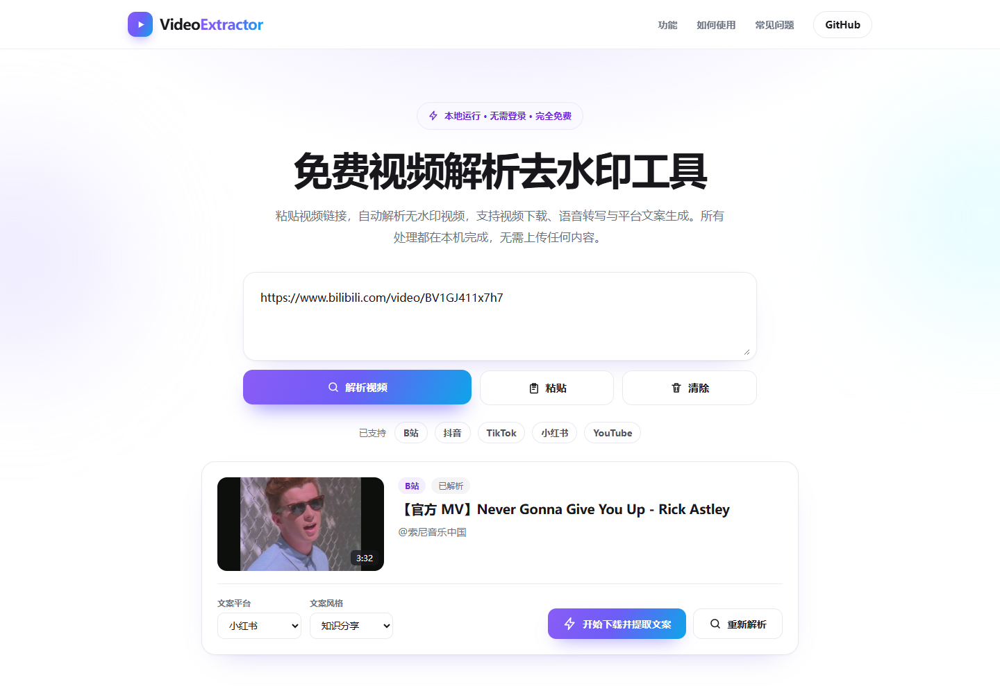
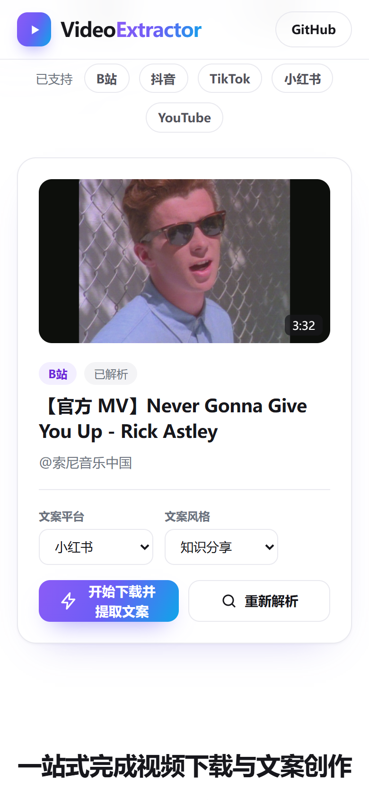
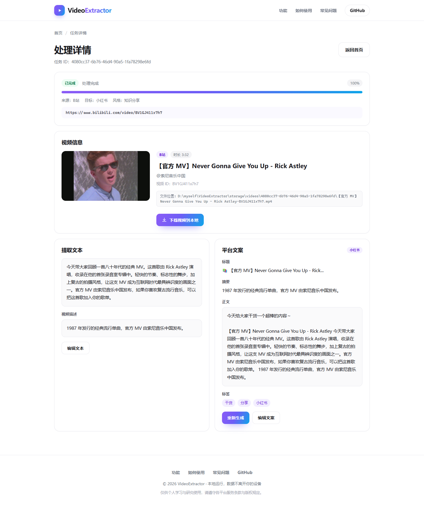
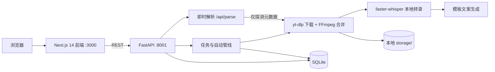

<div align="center">

# VideoExtractor

**V1.0**

免费视频解析、去水印下载与本地文案创作工具（FastAPI + Next.js）

本地运行 · 无需登录 · 数据不上传


</div>

---

## 截图预览

> 粘贴视频链接后自动解析标题、作者、时长与封面，确认后一键在后台完成下载、转录与文案生成。

| 首页 · 粘贴即解析 | 移动端 · 自适应布局 |
| :---: | :---: |
|  |  |

| 任务详情 · 视频信息 / 转录 / 文案 |
| :---: |
|  |

---

## 功能特性

### 解析与下载

- **多平台识别**：自动识别 B站、抖音、TikTok、小红书、YouTube 链接，支持直接粘贴平台分享文本
- **即时解析**：粘贴后自动探测标题、作者、时长、封面与简介，无需等待视频下载
- **无水印下载**：基于 yt-dlp 下载公开视频，抖音分享链接可获取无水印版本
- **画质合并**：内置 FFmpeg 自动合并音视频流，优先选择更高画质

### 转录与文案

- **本地语音转文字**：使用 faster-whisper 在 CPU 上完成转录，首次运行自动下载模型
- **字幕回退**：转录不可用时自动读取视频自带字幕，避免任务中断
- **平台化文案**：按小红书、抖音、B站、TikTok、YouTube 的格式生成标题、摘要、正文与标签
- **四种文案风格**：知识分享、种草带货、测评口吻、剧情叙述
- **可编辑**：转录文本与生成的文案都支持手动修改、重新生成

### 本地任务管理

- **全流程本地**：视频、转录、文案与任务数据均保存在本机，无需上传到第三方服务
- **任务自动执行**：创建任务后后台自动运行下载 → 转录 → 文案管线，可实时查看进度
- **断点重跑**：视频已下载时自动跳过下载，直接重新转录或生成文案
- **一键导出**：在任务详情页将已下载视频保存到本地

---

## 平台支持

| 平台 | 支持的链接 |
| --- | --- |
| B站 | `https://b23.tv/xxx`、`https://www.bilibili.com/video/BVxxx` |
| 抖音 | `https://v.douyin.com/xxx/`、`https://www.douyin.com/video/xxx` |
| TikTok | `https://www.tiktok.com/@user/video/xxx` |
| 小红书 | `https://www.xiaohongshu.com/explore/xxx` |
| YouTube | `https://www.youtube.com/watch?v=xxx`、`https://youtu.be/xxx`、Shorts |

> 遇到需要登录或风控较严的内容时，可通过 Cookie 配置提高解析成功率，详见[配置](#配置)。

---

## 快速开始

### 环境要求

| 依赖 | 版本 / 说明 |
| --- | --- |
| Python | 3.10+ |
| Node.js | 18.17+ |
| FFmpeg | 无需安装，使用 `imageio-ffmpeg` 自带的二进制 |

### 1. 启动后端

```bash
git clone https://github.com/kabuqin/VideoExtractor.git
cd VideoExtractor/backend

python -m venv .venv
.venv\Scripts\activate          # Windows
# source .venv/bin/activate     # macOS / Linux

pip install -e .
playwright install chromium     # 抖音解析所需的浏览器，其他平台可跳过
uvicorn app.main:app --reload --port 8001
```

后端地址：http://localhost:8001  
健康检查：http://localhost:8001/health  
API 文档：http://localhost:8001/docs

### 2. 启动前端

```bash
cd frontend
npm install
npm run dev
```

前端地址：http://localhost:3000

如需修改后端地址，在 `frontend/.env.local` 中设置：

```env
NEXT_PUBLIC_API_BASE_URL="http://localhost:8001/api"
```

### 3. 使用流程

1. 在首页粘贴视频链接或平台分享文本，页面自动解析并展示视频信息；
2. 选择文案平台与风格，点击「开始下载并提取文案」，任务在后台自动执行；
3. 在任务详情页查看下载进度、视频信息、转录文本与平台文案；
4. 按需编辑文本或文案，点击「下载视频到本地」保存视频文件。

---

## 系统架构



| 层 | 技术 | 职责 |
| --- | --- | --- |
| **前端** | Next.js 14 + React + TypeScript | 首页解析、任务进度、转录与文案编辑 |
| **API** | FastAPI + Uvicorn | 解析、任务、视频、转录、文案接口 |
| **管线** | FastAPI BackgroundTasks | 创建任务后自动执行下载、转录与文案生成 |
| **下载** | yt-dlp + imageio-ffmpeg | 平台适配、元数据探测、音视频合并 |
| **转录** | faster-whisper | 本地 CPU 语音转文字，失败时回退字幕 |
| **文案** | 模板规则引擎 | 平台与风格化的标题、摘要、正文、标签 |
| **存储** | SQLite + 本地目录 | 任务数据、视频、字幕与导出文件 |

### 处理管线


- 视频已下载时自动跳过下载步骤；
- 转录失败时自动回退到视频自带字幕；
- 转录或文案生成失败不会导致整个任务崩溃，可随时重新运行；
- 支持对未完成任务重新启动，复用已下载的视频文件。

---

## API

| 方法 | 路径 | 说明 |
| --- | --- | --- |
| `POST` | `/api/parse` | 解析视频链接，返回平台、标题、作者、时长与封面 |
| `POST` | `/api/tasks` | 创建任务，`auto_start` 默认 `true` |
| `GET` | `/api/tasks` | 任务列表 |
| `GET` | `/api/tasks/{task_id}` | 任务状态与进度 |
| `POST` | `/api/tasks/{task_id}/start` | 重新运行未完成任务 |
| `GET` | `/api/videos/{task_id}` | 获取视频元数据 |
| `GET` | `/api/videos/{task_id}/download` | 下载视频文件 |
| `GET` | `/api/transcripts/{task_id}` | 获取转录文本 |
| `PUT` | `/api/transcripts/{task_id}` | 编辑转录文本 |
| `GET` | `/api/copies/{task_id}` | 获取平台文案 |
| `PUT` | `/api/copies/{task_id}` | 编辑平台文案 |
| `POST` | `/api/copies/{task_id}/rewrite` | 按平台与风格重新生成文案 |
| `GET` | `/health` | 健康检查 |

完整请求与响应结构见运行后的交互式文档：http://localhost:8001/docs

---

## 项目结构

```text
VideoExtractor/
  backend/
    app/
      api/routes/      路由（parse, tasks, videos, transcripts, copies）
      core/            配置、异常与 URL 识别
      db/              数据库连接
      models/          SQLModel 数据模型（Task, Video, Transcript, Copy）
      platforms/       平台识别与适配（B站/抖音/TikTok/小红书/YouTube）
      schemas/         请求与响应 Schema
      services/        下载、转录、文案生成
      tasks/           后台管线（video_pipeline）
    data/              SQLite 数据库
  frontend/
    app/               Next.js 页面
    components/        解析、任务、转录与文案组件
    lib/               API Client、平台与 URL 工具
  storage/
    videos/            下载的视频
    audios/            提取的音频
    transcripts/       转录文本
    exports/           导出文件
  screenshots/         README 截图
```

---

## 配置

后端配置读取 `backend/.env`，可从 `backend/.env.example` 复制：

```env
DATABASE_URL="sqlite:///./data/app.db"
STORAGE_ROOT="../storage"
DOWNLOAD_TIMEOUT_SECONDS=600

WHISPER_MODEL="small"
WHISPER_DEVICE="auto"
WHISPER_COMPUTE_TYPE="auto"
```

| 变量 | 默认值 | 说明 |
| --- | --- | --- |
| `DATABASE_URL` | `sqlite:///./data/app.db` | 数据库连接 |
| `STORAGE_ROOT` | `../storage` | 视频、音频与导出文件的存储目录 |
| `DOWNLOAD_TIMEOUT_SECONDS` | `600` | 单个视频的下载超时时间 |
| `WHISPER_MODEL` | `small` | faster-whisper 模型，可选 `tiny` / `base` / `small` / `medium` / `large-v3` |
| `WHISPER_DEVICE` | `auto` | 推理设备，可选 `auto` / `cpu` / `cuda` |
| `WHISPER_COMPUTE_TYPE` | `auto` | 计算精度，CPU 推荐 `int8` |

### Cookie（可选）

部分平台会限制未登录访问。可在 `.env` 中配置：

| 变量 | 说明 |
| --- | --- |
| `BROWSER_COOKIES` | 从本机浏览器读取 Cookie，可选 `chrome` / `edge` / `firefox` / `brave` / `chromium` / `opera` |
| `YOUTUBE_COOKIES_FILE` | YouTube cookies.txt 文件路径（Netscape 格式） |
| `COOKIES_FILE` | 手动指定的 cookies.txt 文件路径，作为浏览器读取失败后的回退 |

### 文案生成

V1.0 的文案由本地模板规则生成，无需任何外部 API 或 API Key。`LLM_*` 配置项为后续版本扩展预留，当前管线不会调用外部大模型。

---

## 开发

```bash
# 后端测试与代码检查
cd backend
pytest
ruff check .

# 前端生产构建
cd ../frontend
npm run build
npm run start
```

---

## 限制说明

- 不支持私密、付费、地区限制或需要额外验证的视频内容；
- 抖音、YouTube 等平台可能存在风控，必要时需要配置 Cookie；
- 首次转录会自动下载 Whisper 模型，之后使用本地缓存；
- 语音转文字默认使用 CPU，较长视频处理可能需要几分钟；
- 当前使用 FastAPI BackgroundTasks 在单进程内执行，适合本地单用户使用；
- 下载与使用视频内容时，请遵守目标平台的服务条款与版权规定。

---

## 参考与致谢

- [yt-dlp](https://github.com/yt-dlp/yt-dlp)：视频解析与下载
- [faster-whisper](https://github.com/SYSTRAN/faster-whisper)：本地语音识别
- [imageio-ffmpeg](https://github.com/imageio/imageio-ffmpeg)：内置 FFmpeg 二进制
- [FastAPI](https://fastapi.tiangolo.com/) / [Next.js](https://nextjs.org/)：后端与前端框架
- 视觉风格参考 [HelloTik](https://www.hellotik.app/zh)

---

## 使用与免责声明

**本项目仅供个人学习、研究与本地技术验证使用。**

- 请仅下载你有权访问与保存的公开视频内容；
- 请遵守所在国家或地区的法律法规以及目标平台的服务条款，不得将下载内容用于侵权、商业传播或其他违法用途；
- 本项目按「现状（AS IS）」提供，不附带任何明示或默示担保，作者不对使用本工具产生的任何直接或间接损失及法律责任负责；
- 下载、安装或使用本项目，即表示你已阅读、理解并同意上述条款。
